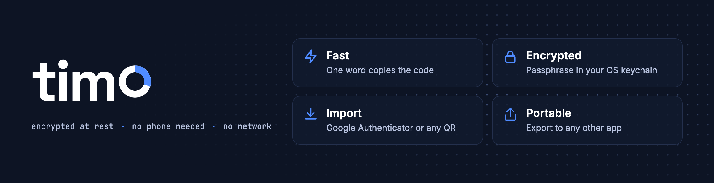

<h1 align="center">
  <picture>
    <source media="(prefers-color-scheme: light)" srcset="https://raw.githubusercontent.com/leomarss/timo/main/assets/banner-light.png">
    
  </picture>
</h1>

<p align="center">
  <b>Your authenticator app, in the terminal, one word away.</b><br>
  <sub><i>Time-based Identity Manager for OTPs</i></sub>
</p>

<p align="center">
  
  
  <a href="https://github.com/leomarss/timo/releases"></a>
  <a href="https://github.com/leomarss/timo/blob/main/LICENSE"></a>
</p>

<p align="center">
  <a href="#demo">Demo</a> ·
  <a href="#install">Install</a> ·
  <a href="#usage">Usage</a> ·
  <a href="#security">Security</a> ·
  <a href="#development">Development</a>
</p>

<br>

## Demo
<p align="center">
  <picture>
    <source media="(prefers-color-scheme: light)" srcset="https://raw.githubusercontent.com/leomarss/timo/main/assets/demo-light.gif">
    
  </picture>
</p>

<br>

Type a word, get the code on your clipboard. No phone, no app switching. Pick from a fuzzy list with `fzf` when you're not sure, import everything from Google Authenticator in one go, and take it all with you when you leave.

- **One word, one code**: copied to your clipboard, cleared after 45s
- **Encrypted at rest**: scrypt + AES-256-GCM, passphrase in your OS keychain
- **Bring your accounts**: Google Authenticator export or any 2FA setup QR, via image, webcam or link
- **Take them with you**: export as setup QR codes or `otpauth://` links to any other app

<br>

## Install

```bash
brew install pipx fzf               # Debian/Ubuntu: sudo apt install pipx fzf
pipx install timo-otp

# Optional: scan QR codes from images and with the webcam
brew install zbar                   # Debian/Ubuntu: sudo apt install zbar-tools
pipx inject timo-otp av zxing-cpp
```

Update with `pipx upgrade timo-otp`.

<br>

## Usage

```bash
timo --initialize    # import a Google Authenticator export (first run sets your passphrase)
timo --add           # add one account from a setup QR, otpauth:// link or secret key
timo github          # copy the code of the account matching "github"
timo                 # pick an account with fzf
```

| Command | What it does |
|---|---|
| `timo WORDS` | Copy the code of the matching account (`--no-copy` to just print it) |
| `--list` · `--stats` | List accounts, or count them per issuer |
| `--watch` | Show every code, live |
| `--add` · `--remove` · `--edit` | Manage single accounts |
| `--export [WORDS]` | Move accounts to another app (`--format uri` for links) |
| `--backup` · `--restore NAME` | Encrypted backups, made automatically before every change |
| `--passwd` · `--forget` | Change the passphrase, or drop it from the keychain |

Run `timo --help` for the full list. Plain words are always a search, so an account can be called `edit` or `list`.

> [!WARNING]
> Your passphrase encrypts everything. **If you forget it, the secrets cannot be recovered**, so keep your original export somewhere safe.

<br>

## Security

- Secrets live in `~/.config/timo/secrets.enc` (override with `TIMO_HOME`), with `700`/`600` permissions and crash-safe writes.
- The `fzf` preview never sees your secrets or passphrase, only the next 10 minutes of codes.
- `--edit` temp files are deleted, webcam frames stay in memory, and export QR codes are cleared from scrollback.
- Exported `otpauth://` links are **not** encrypted: delete them once imported.
- No `sudo`, no network.

<br>

## Development

```bash
python3 -m venv env
env/bin/pip install -e '.[dev]'
env/bin/python -m pytest
```

See [CONTRIBUTING.md](https://github.com/leomarss/timo/blob/main/CONTRIBUTING.md) before opening a pull request, and [SECURITY.md](https://github.com/leomarss/timo/blob/main/SECURITY.md) to report a vulnerability.

<br>

## License

MIT. Built on [fzf](https://github.com/junegunn/fzf), [zbar](https://github.com/mchehab/zbar), [PyAV](https://github.com/PyAV-Org/PyAV) and [zxing-cpp](https://github.com/zxing-cpp/zxing-cpp).
